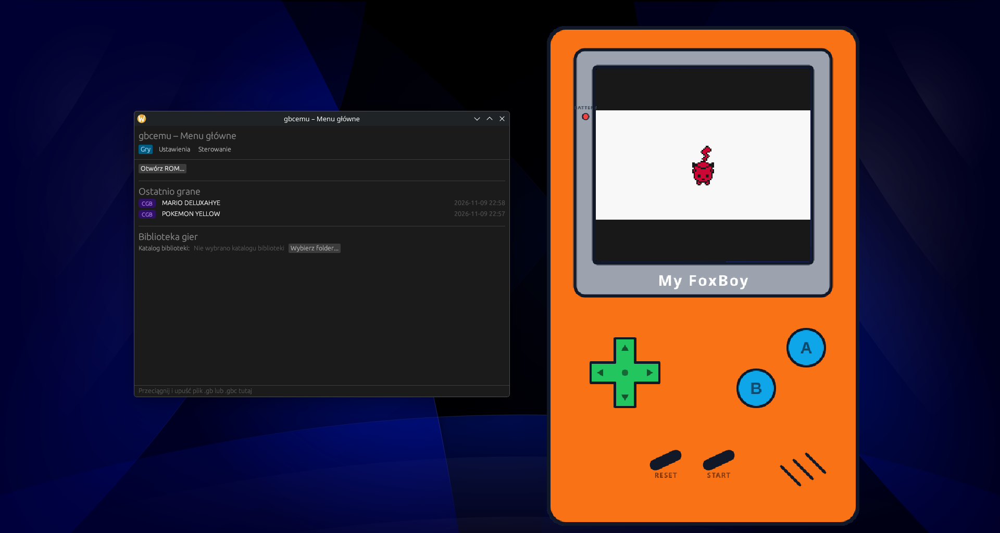

# gbc-foxos

Nowoczesny emulator konsoli Game Boy i Game Boy Color z dedykowanym launcherem graficznym oraz nostalgiczną, przezroczystą obudową konsoli retro („FoxBoy”).


<!-- Miejsce na zrzut ekranu przedstawiający launcher i okno emulatora w przezroczystej ramce -->

---

## O projekcie

`gbc-foxos` to emulator Game Boy / Game Boy Color napisany w języku Rust, zaprojektowany z myślą o prostocie obsługi, wiernej emulacji oraz estetyce retro:
- **Wygodny Launcher (egui)**: Trzy zakładki – biblioteka gier z obsługą przeciągania plików (*Drag & Drop*) i listą ostatnio uruchamianych tytułów, zaawansowane ustawienia grafiki, palet DMG, korekcji kolorów CGB, audio i ścieżek zapisu oraz pełna konfiguracja sterowania z wykrywaniem konfliktów klawiszy.
- **Bezramkowe, przezroczyste okno konsolki**: Po uruchomieniu gry emulator wyświetla się w ramce klasycznej konsolki z przezroczystym tłem, możliwością swobodnego przeciągania oknem myszką oraz płynnego skalowania (kółkiem myszy lub klawiszami `+` / `-`) z zachowaniem proporcji 10:9 i ostrym skalowaniem pikseli (*sharp bilinear* / *integer scaling*).
- **Wydajne audio i synchronizacja**: Silnik APU z dynamiczną kontrolą tempa (Dynamic Rate Control) zapobiega zacinaniu i trzaskom dźwięku.
- **Samodzielny plik wykonywalny**: Wszystkie ikony, grafiki obudowy oraz czcionki są wbudowane w plik binarny – aplikacja nie wymaga żadnych zewnętrznych plików do działania.

> [!NOTE]
> Projekt **nie zawiera żadnych gier ani plików ROM**. Użytkownik musi dostarczyć własne legalne kopie zapasowe gier w formacie `.gb` lub `.gbc`.

---

## Pobieranie i uruchamianie

Gotowe paczki dla systemów Linux i Windows są dostępne w sekcji [Releases](https://github.com/simonexx/gbcemu/releases).

### Linux (x86_64)

1. Pobierz archiwum `gbc-foxos-<wersja>-linux-x86_64.tar.gz`.
2. Rozpakuj archiwum w terminalu lub menedżerze plików:
   ```bash
   tar -xvf gbc-foxos-*-linux-x86_64.tar.gz
   ```
3. Upewnij się, że masz zainstalowane wymagane biblioteki systemowe (w większości dystrybucji są już obecne):
   - Ubuntu / Debian: `sudo apt install libasound2 libxkbcommon0 libwayland-client0 libgtk-3-0`
   - Fedora: `sudo dnf install alsa-lib libxkbcommon wayland-libs gtk3`
   - Arch Linux: `sudo pacman -S alsa-lib libxkbcommon wayland gtk3`
4. Uruchom launcher:
   ```bash
   ./gbc-foxos
   ```
   Możesz także uruchomić grę bezpośrednio z linii poleceń, pomijając launcher:
   ```bash
   ./gbc-foxos /ścieżka/do/gry.gbc
   ```

### Windows (x86_64)

1. Pobierz archiwum `gbc-foxos-<wersja>-windows-x86_64.zip`.
2. Rozpakuj plik `.zip` w wybranym folderze.
3. Uruchom dwukrotnym kliknięciem plik `gbc-foxos.exe`.

> [!WARNING]
> **Komunikat Windows SmartScreen:**  
> Ponieważ plik wykonywalny nie posiada płatnego certyfikatu podpisu cyfrowego, filtr Windows SmartScreen lub program antywirusowy może wyświetlić ostrzeżenie o „Nierozpoznanym wydawcy” (*Unknown Publisher*).  
> Aby uruchomić emulator, kliknij odnośnik **„Więcej informacji”** (*More info*), a następnie przycisk **„Uruchom mimo to”** (*Run anyway*).

---

## Sterowanie

Wszystkie klawisze można dowolnie przypisać w zakładce **Sterowanie** w launcherze. Domyślny układ klawiszy:

| Przycisk Game Boy | Domyślny klawisz |
|---|---|
| **D-Pad Góra** | `Strzałka w górę` / `W` |
| **D-Pad Dół** | `Strzałka w dół` / `S` |
| **D-Pad Lewo** | `Strzałka w lewo` / `A` |
| **D-Pad Prawo** | `Strzałka w prawo` / `D` |
| **A** | `Z` / `J` |
| **B** | `X` / `K` |
| **Start** | `Enter` |
| **Select** | `Prawy Shift` / `Spacja` |

### Skróty klawiszowe i obsługa okna

| Akcja | Klawisz / Mysz |
|---|---|
| **Przyspieszenie (Fast-forward)** | `Spacja` / `F` |
| **Pauza** | `P` |
| **Reset konsoli** | `R` |
| **Szybki zapis stanu (Quick Save)** | `F5` |
| **Szybki odczyt stanu (Quick Load)** | `F6` |
| **Zrzut ekranu** | `F12` |
| **Pełny ekran** | `F11` |
| **Powrót do launchera** | `Esc` |
| **Menu podręczne** | `Prawy przycisk myszy` (Pauza, Reset, Powrót, Zamknij) |
| **Przesuwanie okna** | Wciśnij i przeciągnij lewym przyciskiem myszy za obudowę konsoli |
| **Zmiana rozmiaru okna** | Kółko myszy (*Scroll*) lub klawisze `+` / `-` |
| **Zamknięcie aplikacji** | `Alt + F4` / `Ctrl + Q` |

---

## Kompilacja ze źródeł

Wymagane jest środowisko [Rust](https://www.rust-lang.org/) (wersja stabilna 1.88 lub nowsza).

### 1. Zależności systemowe (Linux)

Na systemie Linux (np. Ubuntu / Debian) zainstaluj pakiety deweloperskie:
```bash
sudo apt-get update
sudo apt-get install -y libasound2-dev libxkbcommon-dev libwayland-dev libx11-dev libgtk-3-dev
```

### 2. Klonowanie i budowanie

```bash
git clone https://github.com/simonexx/gbcemu.git
cd gbcemu

# Kompilacja wersji zoptymalizowanej (Release)
cargo build --release -p gbc-app
```

Skompilowany plik binarny znajdziesz w:
- Linux: `target/release/gbc-app`
- Windows: `target/release/gbc-app.exe`

Możesz uruchomić launcher poleceniem:
```bash
cargo run --release -p gbc-app
```
lub od razu podać plik z grą:
```bash
cargo run --release -p gbc-app -- gra.gbc
```

### Uruchamianie testów

```bash
cargo test --workspace
```
Testy weryfikują m.in. instrukcje procesora SM83, timery, przerwania oraz układ dźwiękowy APU w oparciu o zestaw testowy Blargg oraz Mooneye.

---

## Struktura projektu

- `gbc-core/` – Niezależny od platformy rdzeń emulacji Game Boy / Game Boy Color (brak I/O, brak zależności zewnętrznych).
- `gbc-app/` – Graficzny interfejs użytkownika (launcher `egui`/`eframe`, okno emulatora `winit` + `pixels`, silnik dźwięku `cpal`).

---

## Licencja 
Obudowa MyFoxBoy: autor @foxo_kido95,Nie jest objęta licencją MIT.
Projekt udostępniany jest na warunkach licencji [MIT](LICENSE).

